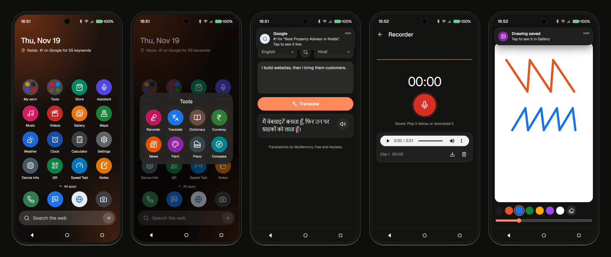
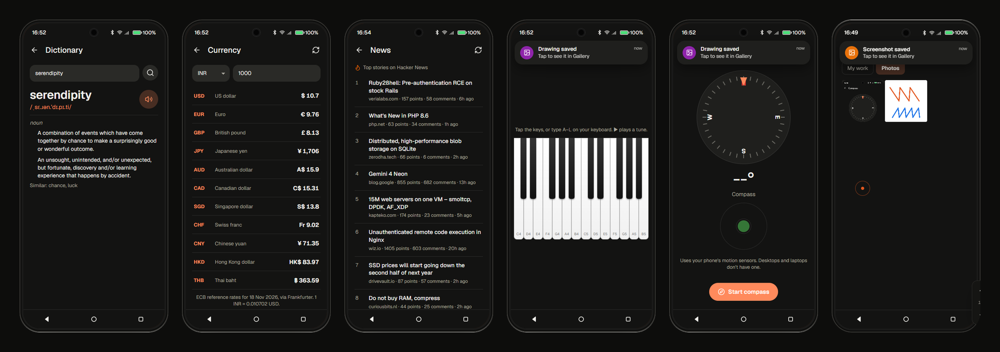

# AK Phone

An Android-style phone that runs inside a web page. 28 working apps and 9 games, written in plain HTML, CSS and JavaScript: no framework, no build step, no backend.

**[Try it live →](https://anekkumar9518.github.io/ak-phone/)**



I built it for my portfolio as a way to show front-end work you can actually touch. It started as a lock screen and a browser, and kept growing.

## What works

**System.** Boot animation, lock screen, a status bar that shows your real battery level (in browsers that share it), notification shade with quick-settings tiles and a brightness slider, home screen with folders, an app drawer with search, recents, back/home/recents navigation, a power menu (hold the power key), volume keys, charging and low-battery alerts, vibration, light and dark themes, and an on-screen keyboard.

**Apps.** Browser (real sites and Google), Store, Settings, Phone, Messages, Camera, Gallery, Maps, Weather, Clock (stopwatch and timer), Calculator, Calendar, Notes, Files, a voice Assistant, Music (live radio), Videos, Device Info, QR scanner and generator, and an internet Speed Test.

**Tools.** Recorder with a live waveform · Translate (16 languages, read aloud) · Dictionary with pronunciation · Currency with live ECB rates · News (Hacker News top stories) · Paint with undo · a two-octave Piano · Compass with a spirit level · a Screenshot tile that saves the screen to Gallery.

**Games.** 2048, Tic Tac Toe (a minimax bot, so a draw is a good result), Snake, Flappy, Memory, Minesweeper, Bricks, Sudoku and Lead Catcher. They install from the Store, and best scores are kept on your device.



## How it's put together

```
assets/js/android.js        system UI, window manager and core apps
assets/js/android-apps.js   assistant, music, videos, QR, speed test, games
assets/js/android-more.js   tools: recorder, translate, dictionary, currency, news, paint, piano, compass
assets/css/android.css      phone frame and system UI
assets/css/android-more.css styles for the tools
assets/css/demo.css         the demo page around the phone
index.html                  the demo page
```

Each app is a function that receives an empty `<section>` and returns optional hooks (`show`, `hide`, `back`, `destroy`). A small window manager opens, switches and closes them, and settings, notes and installed games live in `localStorage`. Adding an app looks like this:

```js
const { APPS, RUN, bar } = window.AKPhone;
APPS.hello = { n: "Hello", i: "smile", c: "#1a73e8", tool: true }; // name, Lucide icon, colour
RUN.hello = (el) => {
  el.innerHTML = bar("Hello") + `<div class="dapp-body"><p>Hi from a new app.</p></div>`;
  return { back: () => false };
};
```

Most of the work is done by browser APIs: Web Speech (assistant), MediaRecorder and Web Audio (recorder, piano, sounds), `getUserMedia` and BarcodeDetector (camera, QR), DeviceOrientation (compass), the Battery and Vibration APIs, and the Media Session API.

Live data comes from free, keyless services: [Open-Meteo](https://open-meteo.com) for weather, [Frankfurter](https://frankfurter.dev) for exchange rates, [MyMemory](https://mymemory.translated.net) for translation, [dictionaryapi.dev](https://dictionaryapi.dev), the [Hacker News API](https://github.com/HackerNews/API), and Cloudflare's speed-test endpoints. Nothing you record, draw or type leaves the browser.

## Run it locally

It's static, so any web server works:

```sh
git clone https://github.com/Anekkumar9518/ak-phone.git
cd ak-phone
python -m http.server 8000
```

Then open http://localhost:8000. The camera, microphone and compass need `localhost` or HTTPS.

## Limits

It's a simulator. Real Android apps and Google Play can't run in a web page, so every app here is written for this phone. Many websites refuse to be shown inside another page, so the browser opens those as mobile snapshots with a button to the live site. The compass needs a phone, since desktops have no motion sensor.

## Credits

Icons by [Lucide](https://lucide.dev) (ISC). QR codes by [qrcode-generator](https://github.com/kazuhikoarase/qrcode-generator), QR scanning fallback by [jsQR](https://github.com/cozmo/jsQR), screenshots by [html-to-image](https://github.com/bubkoo/html-to-image) (all MIT).

The "My work" folder, the snapshots and the Assistant's answers are about my own projects. If you reuse the phone, swap them out in `SITES` (top of `android.js`) and in the Assistant's answers (`android-apps.js`).

Made by [Anek Kumar](https://www.anekkumar.in), a full stack developer and digital marketer in Noida, India. MIT licensed.
